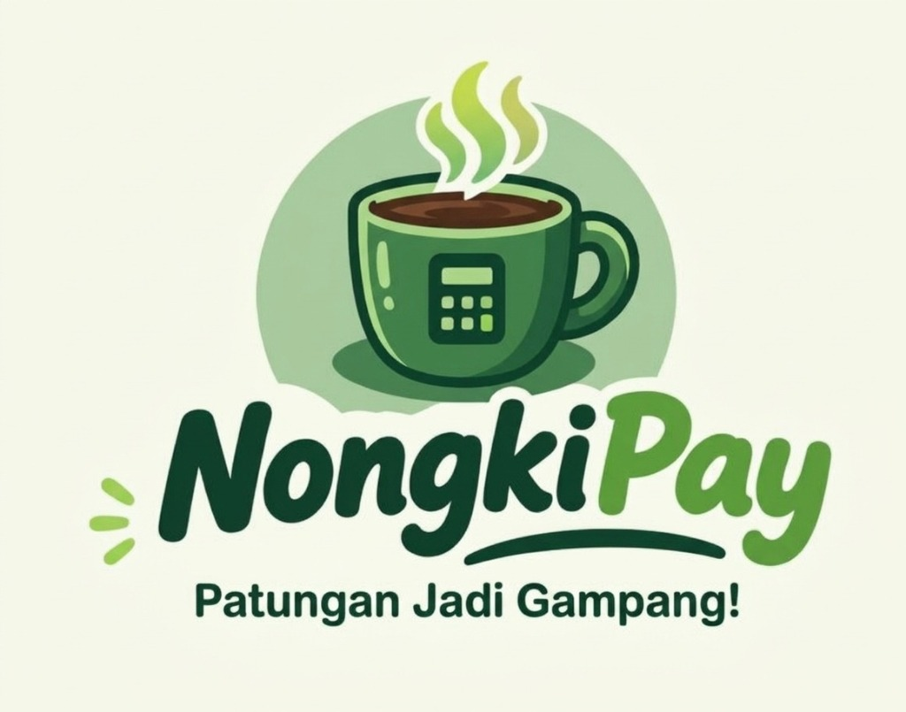

# ☕ NongkiPay — Patungan Jadi Gampang!
### *Kalkulator Split Bill Online Praktis, Cepat, dan Transparan*

**NongkiPay** adalah aplikasi web modern, cerdas, dan interaktif untuk menghitung dan membagi tagihan nongkrong (*split bill*) secara adil, transparan, dan tanpa ribet. Dilengkapi navigasi tab beranimasi, auto-save otomatis, mode pembagian biaya proporsional/rata, pembulatan cerdas, manajemen **E-Wallet & Bank Transfer**, template **Struk Digital 1 Lembar PDF dengan Watermark Logo**, **Spin Wheel Nongkrong**, serta integrasi langsung **WhatsApp**.

---

## 👨‍💻 Tim Pengembang (Developers)

Aplikasi orisinal ini dikembangkan dengan dedikasi oleh:
- **👨‍💻 Fajri**
- **👨‍💻 Misael**
- **👨‍💻 Galuh**

*&copy; 2026 NongkiPay. Hak cipta dilindungi undang-undang.*

---

## 🚀 Fitur Unggulan

1. **🎨 Desain & Navigasi Tab Beranimasi**:
   - Logo cangkir kopi kalkulator NongkiPay beresolusi tinggi dengan animasi float halus.
   - Navigasi tab interaktif dengan animasi transisi mulus dan tombol akses cepat di banner utama (`➕ Tambah Menu Pesanan`, `👥 Kelola Teman`, `🎡 Spin Penentu`, `🔗 Bagikan Link`).

2. **🏷️ Judul Acara & Auto-Save Otomatis**:
   - Simpan nama kafe/acara nongkrong agar tampil di Struk PDF dan ringkasan WhatsApp.
   - Data tagihan tersimpan otomatis di browser (`localStorage`), tidak hilang jika halaman tidak sengaja ter-refresh.

3. **⚡ Menu Cepat & Bagi Rata Total Bill**:
   - Preset menu kafe sekali klik (`Kopi Susu`, `Es Teh`, `Nasi Goreng`, `Kentang Sharing`, `Cemilan`).
   - Fitur **⚡ Bagi Rata Total** untuk langsung membagi total struk ke semua teman tanpa perlu ketik menu satu per satu.

4. **⚖️ Pajak, Service & Diskon Fleksibel + Pembulatan Cerdas**:
   - Pilih pembagian pajak/service/diskon secara **Proporsional** (sesuai pesanan) atau **Bagi Rata** per kepala.
   - Pembulatan tagihan otomatis ke kelipatan **Rp 100**, **Rp 500**, atau **Rp 1.000** agar nominal transfer lebih rapi.

5. **🎡 Spin Wheel Nongkrong (Mini-Game)**:
   - Putar roda keberuntungan interaktif untuk menentukan siapa yang maju talangin ke kasir, bayar parkir/tips, atau traktir ronde berikutnya!

6. **🧾 Struk Digital 1 Lembar Pas (PDF) dengan Logo Transparan**:
   - Template struk kasir resmi kafe beresolusi tinggi dengan **Watermark Logo NongkiPay Transparan** di tengah kertas.
   - Otomatis menyesuaikan skala agar muat **1 lembar** saat disimpan sebagai PDF atau dicetak.

7. **💳 Tracking Lunas, Rekening Bank/E-Wallet & WhatsApp Langsung**:
   - Progress bar dana terkumpul + tombol `✓ Semua` lunas.
   - Dukungan 12 bank & e-wallet Indonesia (DANA, GoPay, ShopeePay, SeaBank, NeoBank, OVO, Mandiri, BRI, BCA, BNI, BTN, BSI).
   - Tombol **Salin WA**, **📲 Kirim Langsung ke WhatsApp**, dan **🔗 Bagikan Link Tagihan**.

---

## 🌐 Cara Deploy Agar Bisa Dipakai Semua Orang (Online)

1. Buka browser dan kunjungi: **[app.netlify.com/drop](https://app.netlify.com/drop)**
2. Tarik dan lepas (*drag & drop*) file `nongkipay-deploy.zip` atau folder `split-bill-ocr` ke halaman tersebut.
3. Dalam hitungan detik, Netlify akan memberikan URL publik aktif gratis (misal: `https://nongkipay.netlify.app`) yang langsung bisa dibuka siapa pun!
